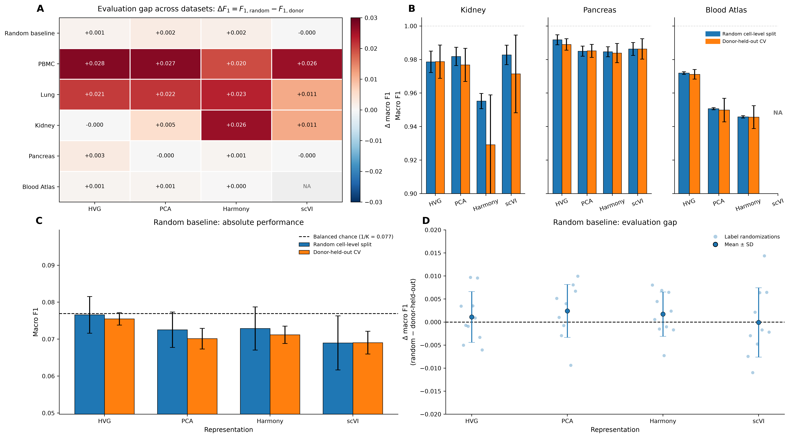

# Cross-donor generalization in single-cell classification

**Random cell-level splits can overestimate performance on unseen donors.** Across PBMC and lung, random splitting yields higher macro F1 than donor-held-out evaluation, even after technical covariate adjustment and donor-level modeling. Gaps are smaller near perfect or chance-level classification. **Evaluation should hold out donors when claims concern generalization to new individuals.**

## Manuscript

**Title:** *Evaluation design shapes estimates of cross-donor generalization in single-cell classification of cell-type*  
**Authors:** Xingyi Chen, Jiabei Li, Alexis Battle  
**Venue:** bioRxiv (2026)  
**DOI:** https://doi.org/10.64898/2026.10.26.761949

If you use this code or these analyses, please cite the manuscript above.

## Study overview

We compare five repeated 80/20 random cell-level splits with five-fold donor-held-out cross-validation using logistic regression. Benchmarks span PBMC, lung, kidney, pancreas, and Blood Atlas, with HVG, PCA, Harmony, and scVI representations where available. Macro F1 is the primary metric. Additional analyses include technical covariates, donor ablation, correctness mixed models, cross-site transfer, and randomized-label controls.

Representations are constructed before classifier splitting, so the comparison measures classifier generalization conditional on shared cohort-level representations. Held-out donors may contribute to representation construction.



## Data

**The `data/` folder is deposited on [Zenodo](https://doi.org/10.5281/zenodo.19717558).** Download and restore data files under the repository's `data/` directory. Expression matrices are excluded from GitHub; expected paths and preprocessing inputs are listed in [data/README.md](data/README.md). Saved numerical results and figure caches are in [results/](results/).

## Reproduction

Use Python 3.12 and run from the repository root:

```bash
python -m pip install numpy pandas scipy matplotlib==3.11.1 scikit-learn pyyaml anndata scanpy harmonypy scvi-tools statsmodels jupyterlab ipykernel
python -m pip install -e .
```

With benchmark-ready inputs restored from Zenodo:

```bash
python scripts/run_all_benchmarks.py
python scripts/run_correctness_glmm.py --benchmark-config configs/benchmarks/pbmc_no_batch.yaml --site-col Site
python scripts/run_correctness_glmm.py --benchmark-config configs/benchmarks/lung_no_batch.yaml --site-col batch
python scripts/run_synthetic_floor.py
```

To rebuild benchmark-ready inputs, arrange the preprocessing inputs documented in [data/README.md](data/README.md), then run `python scripts/run_all_preprocessing.py`. PBMC requires its existing subsampled checkpoint and scVI embedding; Blood Atlas requires the [Stage-0 checkpoint](notebooks/preprocessing/blood_atlas_stage0_subsample.ipynb). Use a separate working copy for new runs because commands write analysis outputs.

Run [notebooks/figures/](notebooks/figures/) to recreate manuscript figures; PNG and TIFF exports at 350 DPI go to `figures/main/` and `figures/supplementary/`. Figures 2, 3, S1, and S3 require benchmark-ready H5AD inputs. PBMC matching analyses for Figure S4 are in [notebooks/diagnostics/pbmc_transfer_diagnostics.ipynb](notebooks/diagnostics/pbmc_transfer_diagnostics.ipynb).

## Repository layout

| Path | Contents |
| --- | --- |
| `configs/preprocessing/`, `configs/benchmarks/` | Cohort preprocessing and evaluation settings |
| `src/scrna_benchmark/`, `scripts/` | Analysis code and command-line runners |
| `data/` | Data documentation and local inputs restored from Zenodo |
| `notebooks/preprocessing/` | QC and Blood Atlas Stage-0 preparation |
| `notebooks/figures/`, `notebooks/diagnostics/` | Manuscript figures and PBMC transfer diagnostics |
| `results/` | Metrics, predictions, preprocessing summaries, and figure caches |
| `figures/main/`, `figures/supplementary/` | Exported manuscript figures |
| `archive/` | Historical course-project materials |
