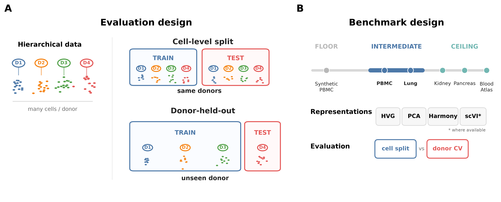
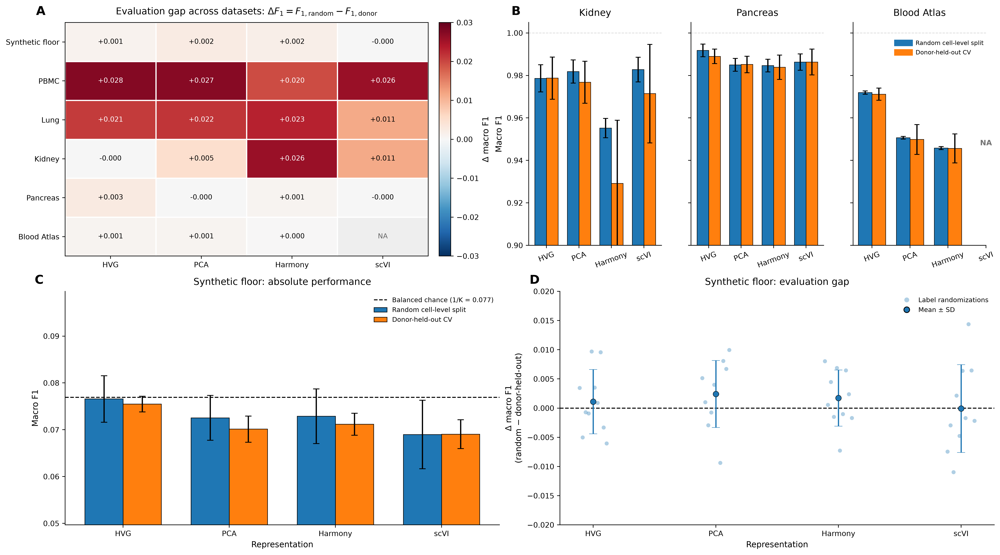

# Random Cell-Level Splits Introduce Systematic Bias in scRNA-seq Cell Type Annotation

This project examines how evaluation design affects cell-type classification performance in single-cell RNA sequencing. We compare random cell-level splitting, where training and test cells can share donors, with donor-held-out cross-validation across five biological cohorts.

**Status:** analyses are finalized and the manuscript is in preparation. A complete data and results deposit on Zenodo is planned.

## Study overview

| Cohort | Cells | Donors | Cell types |
| --- | ---: | ---: | ---: |
| PBMC | 10,107 | 23 | 13 |
| Lung | 83,966 | 104 | 31 |
| Kidney | 8,746 | 19 | 9 |
| Pancreas | 8,500 | 17 | 9 |
| Blood Atlas | 108,682 | 166 | 7 |

The benchmark uses logistic regression with HVG, PCA, Harmony, and scVI representations; Blood Atlas excludes scVI because raw counts are unavailable. Biological cohorts use five repeated 80/20 cell-level splits and five donor-held-out folds, with macro F1 as the primary metric. Additional analyses include site/batch covariates, donor ablation, correctness mixed models, cross-site transfer, and a synthetic-label floor control.

Representations are prepared before classifier splitting, so donor-held-out evaluation measures classifier generalization conditional on these shared representations.

## Key findings and figures

Random cell-level splitting yields higher macro F1 across all evaluated representations in PBMC and lung. Smaller gaps occur in high-performance cohorts and in the synthetic-label floor control, showing why evaluation gaps should be interpreted alongside absolute performance.

**Figure 1 — Evaluation design.** [Notebook](manuscript_figures/notebooks/Figure1_motivation.ipynb)



**Figure 4 — Evaluation gaps across cohorts and performance regimes.** [Notebook](manuscript_figures/notebooks/Figure4_ceiling_floor.ipynb)




## Data availability

Expression matrices are excluded from GitHub. See [data/README.md](data/README.md) for expected filenames. Complete processed inputs are documented on Zenodo.

Saved metrics, predictions, preprocessing summaries, and figure caches are in [results/](results). The complete working inputs and lung GLMM results are available on Zenodo.

## Reproduction

### Figures from saved results

Run the notebooks in [manuscript_figures/notebooks/](manuscript_figures/notebooks). They export PNGs at **350 DPI** to `figures/manuscript/`.

Figures 1 and 4 and supplementary figures S2, S4, and S5 can use the tracked results and caches. Run the supplementary setup cell before the selected figure cells. Figures 2, 3, S1, and S3 require the corresponding H5AD inputs; Figure 3 also requires the lung GLMM results.

### Full-analysis reproduction

Arrange the inputs as described in [data/README.md](data/README.md), then run:

```bash
python scripts/run_all_preprocessing.py
python scripts/run_all_benchmarks.py
python scripts/run_correctness_glmm.py --benchmark-config configs/benchmarks/pbmc_no_batch.yaml --site-col Site
python scripts/run_correctness_glmm.py --benchmark-config configs/benchmarks/lung_no_batch.yaml --site-col batch
python scripts/run_synthetic_floor.py
```

These commands write analysis outputs; use a separate copy for new runs. Skip preprocessing when benchmark-ready objects are available. PBMC requires its existing subsampled checkpoint and scVI embedding; Blood Atlas requires its [Stage-0 checkpoint](notebooks/preprocessing/blood_atlas_stage0_subsample.ipynb). Additional PBMC transfer diagnostics are in [this notebook](notebooks/figures/pbmc_manuscript_figures.ipynb).

## Repository layout

| Directory | Contents |
| --- | --- |
| `configs/` | Preprocessing and benchmark settings |
| `src/`, `scripts/` | Analysis code and command-line runners |
| `data/` | Local expression inputs, excluded from Git |
| `results/` | Saved numerical outputs and figure caches |
| `notebooks/` | QC, component figures, and diagnostics |
| `manuscript_figures/notebooks/` | Final manuscript figure notebooks |
| `figures/` | Exported figures |
| `archive/` | Historical course-project materials |

## Citation and license

Citation is coming soon.

Code is available under the [MIT License](LICENSE).
